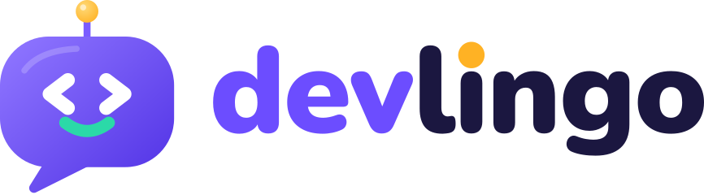

<p align="center">
  <picture>
    <source media="(prefers-color-scheme: dark)" srcset="brand/logo/logo-horizontal-on-dark.svg">
    
  </picture>
</p>

<p align="center"><strong>Aprenda programação jogando.</strong></p>

# Devlingo Bot

Bot de Discord estilo Duolingo para aprender programação, feito em JavaScript com discord.js (v14.19.3 ou mais novo).

- **Components V2:** todas as mensagens usam Container, Text Display, Section, Separator e botões, sem embeds.
- **Sem slash commands e sem intents privilegiadas:** o bot responde quando é marcado num servidor ou quando recebe uma DM. Isso evita a revisão de acesso do Discord ao crescer.
- **Handlers:** comandos, eventos e botões ficam em pastas e são carregados automaticamente.

## Como usar

No servidor, marque o bot no começo da mensagem. Na DM, escreva direto.

| Servidor | DM | O que faz |
| --- | --- | --- |
| `@Devlingo configurar` | `configurar` | escolhe suas áreas (Frontend, Backend...) e seu nível; dá para mudar quando quiser |
| `@Devlingo aprender` | `aprender` | trilha de estudo: escolhe o assunto exato e só pergunta sobre ele |
| `@Devlingo desafio` | `desafio` | desafio aleatório do seu nível e das suas áreas (ou `desafio python`, `javascript`, `sql`, `git`) |
| `@Devlingo cursos` | `cursos` | cursos com certificado: o seu progresso em cada módulo e o que praticar a seguir |
| `@Devlingo certificados` | `certificados` | seus certificados (a imagem em PNG) e o nome que sai neles: `certificados nome Ana Souza` |
| `@Devlingo verificar DVL-XXXX-XXXX` | `verificar DVL-XXXX-XXXX` | confere se um certificado é verdadeiro e de quem é |
| `@Devlingo perfil` | `perfil` | nível, XP, sequência, meta do dia, estatísticas e trilha |
| `@Devlingo ranking` | `ranking` | top 10 do servidor (na DM, ranking global) e a sua posição |
| `@Devlingo conquistas` | `conquistas` | suas medalhas: as que você já ganhou e as que faltam |
| `@Devlingo ajuda` | `ajuda` | lista de comandos, agrupada por tipo |

As telas têm botões de atalho (📚 Estudar, 🎓 Cursos, 👤 Perfil, 🏆 Ranking, 🏅 Conquistas, ⚙️ Configurar) para andar entre elas sem digitar.

O XP e a sequência são globais por pessoa; o ranking do servidor conta só o XP ganho naquele servidor. Cada desafio expira em 5 minutos e só quem pediu pode responder.

**Limite diário:** cada pessoa ganha no máximo 200 XP por dia. Depois disso ainda dá para treinar e ler as explicações, mas o XP só volta no dia seguinte (o `perfil` mostra o XP de hoje). O "dia" muda à meia-noite de `America/Sao_Paulo`, não do servidor onde o bot roda.

### Estímulos de hábito

O bot recompensa quem volta todo dia, sem punir quem falha:

- 🎯 **Meta do dia:** 5 respostas por dia (certas ou erradas) cumprem a meta e rendem **+15 XP**, uma vez por dia. A barra aparece em toda resposta e no `perfil`.
- 🔥 **Sequência e marcos:** a sequência cresce na primeira resposta de cada dia. Os marcos de 3, 7, 14, 30, 60 e 100 dias dão XP de bônus (+10, +30, +60, +150, +300 e +500). O `perfil` mostra o próximo marco e avisa, sem pressão, quando a sequência está em risco hoje.
- ⚡ **Combo:** acertos seguidos mostram um combo; a cada 5, **+5 XP**. Errar zera (o bot avisa, sem drama).
- 🆙 **Níveis e títulos:** cada 100 XP é um nível. Títulos: 🌱 Semente, 🌿 Broto, 🌳 Árvore, ⚡ Faísca, 🔥 Chama e 👑 Lenda. Subir de nível é comemorado na própria resposta (a mensagem fica dourada).
- 🏅 **Conquistas:** 13 medalhas (primeiro passo, 10/50/100 acertos, sequências, combos, meta, nível Especialista...). O comando `conquistas` mostra as ganhas e as que faltam.
- 📍 **Ranking com a sua posição**, mesmo fora do top 10.

Os bônus ficam **fora** do limite diário de XP: são raros e premiam constância, não volume (e o combo só dá bônus quando o XP da resposta entrou). Os valores estão em `src/config.js`; `DAILY_GOAL` no `.env` muda a meta ou a desliga (`0`). Quem já usava o bot começa as estatísticas e conquistas do zero, mas mantém XP e sequência.

### Configuração inicial (`configurar`)

Na **primeira vez** que alguém usa `aprender` ou `desafio`, o bot pede a configuração antes de qualquer pergunta (são dois passos, uns 10 segundos):

1. **Áreas**, uma ou mais: 🎨 Frontend, ⚙️ Backend, 🗄️ Banco de dados, 🛠️ Ferramentas e DevOps.
2. **Nível** (🟢 Iniciante, 🟡 Intermediário, 🟠 Avançado, 🔴 Especialista), o ponto de partida.

Depois disso, `aprender` já abre nos assuntos do seu nível e das suas áreas, e `desafio` sorteia só dali. Dá para mudar a qualquer momento com `configurar` (ou pelo botão **Alterar minha trilha**); XP e sequência não mudam. `perfil`, `ranking` e `ajuda` funcionam sem configurar.

A configuração fica salva por pessoa (vale em todos os servidores e na DM). Só aparecem áreas e níveis que já têm desafios cadastrados.

#### Sugestão de subir de nível

O bot olha as **últimas 20 respostas no seu nível** (só perguntas do nível escolhido em `configurar` entram na conta). Se a janela está cheia e você acertou **pelo menos 90%**, a resposta certa seguinte vem com o convite e um botão **Subir para ...**. Detalhes:

- **Nada muda sozinho.** O nível só sobe se você tocar no botão, que só oferece o nível logo acima (e confirma numa mensagem à parte, para a explicação da pergunta continuar na tela).
- Depois de convidar, a contagem **recomeça do zero**: quem ignora o convite só o recebe de novo depois de outras 20 respostas boas. Trocar de nível em `configurar` também zera a contagem; mudar só as áreas, não.
- No 🔴 Especialista não há para onde subir, então não aparece convite.
- `LEVEL_UP_WINDOW` e `LEVEL_UP_PERCENT` no `.env` mudam o tamanho da janela e o mínimo de acerto (`LEVEL_UP_WINDOW=0` desliga). Quem já jogava começa a contagem do zero.

### Trilha de estudo (`aprender`)

1. O menu mostra os assuntos do seu nível, só das suas áreas. **Ver todas as áreas** mostra os de fora, sem mexer na sua configuração.
2. Escolha o **assunto exato** (por exemplo, "Funções em JavaScript" ou "Consultas SQL"): você só recebe perguntas dele.
3. Responda. Depois de cada resposta, **Próxima pergunta** sorteia outra do mesmo nível e assunto, **Trocar assunto** volta à lista de assuntos do nível e **Trocar nível** escolhe outro nível só para essa sessão.

**Sem repetição à toa:** o bot lembra de cada pergunta que você já viu. O sorteio vai primeiro às que você **nunca viu**, depois às que viu mas **ainda não acertou**, e só no fim volta às que você já acertou (as acertadas há mais tempo primeiro, para servir de revisão). A pergunta que acabou de sair nunca repete em seguida.

### Cursos e certificados (`cursos`)

Cada curso junta alguns assuntos (os **módulos**) e tem um certificado **por nível**, então um curso rende até quatro: Iniciante, Intermediário, Avançado e Especialista. Hoje são quinze cursos: 🟨 JavaScript do zero, 🟦 TypeScript na prática, 🎨 Frontend na prática (HTML, CSS e DOM), 🔌 HTTP e APIs REST, 🔐 Segurança web, 🧪 Testes automatizados, 🌐 Redes na prática, 🐍 Python do zero, 🧮 Estruturas de dados, 🕸️ Algoritmos de grafos, 🗄️ SQL essencial, 🧱 Modelagem de dados, 🐳 Linux e Docker, 🚀 CI/CD com GitHub Actions e 🔀 Git na prática.

- **Como conclui um módulo:** acertar **75% das perguntas diferentes** daquele assunto e nível (arredondado para cima). Acertar a mesma pergunta de novo não conta, e errar não tira o que já foi acertado. O nível do curso fecha quando **todos** os módulos dele passam, e o certificado sai na hora, na própria resposta que fechou, com um botão **Ver meu certificado**.
- **Quem estuda de qualquer jeito também avança:** o progresso conta pelas perguntas acertadas em `aprender`, `desafio` ou pelo botão **Praticar** da tela do curso. Cada resposta mostra uma linha com quanto falta para o certificado.
- **O certificado:** uma imagem PNG (1600×1131) com o seu nome, o curso, o nível, os módulos, a data e um código `DVL-XXXX-XXXX`. Só você consegue pedir a imagem (a resposta vai escondida, só para você), mas o código serve para qualquer pessoa conferir com `verificar`.
- **O nome:** o primeiro certificado usa o seu nome do Discord (só letras; emoji, números e símbolos saem). Para trocar: `certificados nome Ana Beatriz Almeida`. A troca vale para todos os certificados, inclusive os antigos.
- **Muitos certificados:** a lista de `certificados` mostra os mais recentes que cabem numa mensagem do Discord (que aceita 4000 caracteres de texto) e avisa quantos ficaram de fora; o código de cada um continua na tela do curso (`cursos`) e serve para o `verificar`.
- **Custa nada:** é tudo gerado pelo próprio bot, sem serviço externo.

O mínimo de 75% muda com `COURSE_PASS_PERCENT` no `.env`. Diferente do XP, o certificado **não** tem limite diário.

## Como rodar

Precisa do [Node.js](https://nodejs.org) 22.13 ou mais novo (o banco SQLite vem embutido no Node, sem instalar nada a mais).

1. Crie o bot no [Discord Developer Portal](https://discord.com/developers/applications), aba **Bot**. Não precisa ligar nenhuma Privileged Gateway Intent.
2. Copie o token e convide o bot ao servidor (OAuth2 → URL Generator → escopo `bot`; permissões: View Channels, Send Messages, Read Message History, Add Reactions).
3. No projeto:

```bash
npm install
cp .env.example .env     # Windows: copy .env.example .env
# edite o .env e coloque o DISCORD_TOKEN
npm start                # ou npm run dev para reiniciar ao salvar
```

**Nunca** suba o `.env` para o GitHub (já está no `.gitignore`).

**Uma instância por token.** Cada instância ligada responde a todas as mensagens, então, se o bot rodar em dois lugares com o mesmo token (por exemplo, no seu computador e no workflow manual do GitHub Actions), **toda mensagem é respondida duas vezes**. Para desenvolver, crie um segundo bot de teste no Developer Portal (outro token, no seu `.env`) e deixe o token do bot de verdade só no lugar onde ele roda de fato.

Variáveis opcionais do `.env` (todas explicadas no `.env.example`):

| Variável | Padrão | Para quê |
| --- | --- | --- |
| `ALLOWED_CHANNEL_ID` | vazio | nos servidores, o bot só responde nesse canal |
| `DAILY_XP_CAP` | `200` | máximo de XP por pessoa por dia (`0` = sem limite) |
| `DAILY_GOAL` | `5` | respostas por dia que cumprem a meta diária (`0` = sem meta) |
| `COURSE_PASS_PERCENT` | `75` | % das perguntas de um módulo que precisa acertar para concluí-lo (de 1 a 100) |
| `LEVEL_UP_WINDOW` | `20` | últimas respostas no seu nível que contam para sugerir subir (`0` = não sugerir) |
| `LEVEL_UP_PERCENT` | `90` | % de acerto nessa janela para receber a sugestão (de 1 a 100) |
| `TIMEZONE` | `America/Sao_Paulo` | fuso que define "o dia" da sequência e do limite diário |
| `DB_PATH` | `data/devlingo.db` | onde fica o banco |

**Dados:** o progresso fica em SQLite (`data/devlingo.db`, ignorado pelo git; faça backup dessa pasta). Se existir um `data/data.json` da versão antiga, ele é importado sozinho na primeira inicialização e guardado como `data.json.migrated`.

**Testes:** `npm test` roda tudo sem token e sem internet.

Quer contribuir? Veja o [CONTRIBUTING.md](CONTRIBUTING.md).

## Estrutura

```
src/
  devlingo.js           cria o cliente e carrega os handlers
  config.js             XP, limite diário, fuso, banco, tempos, cores
  commands/             um arquivo por comando
  events/               um arquivo por evento do Discord
  buttons/              um arquivo por tipo de botão ou menu (prefixo do customId)
  handlers/             carregam commands/, events/ e buttons/
  utils/                ui e courseUi (Components V2), db (SQLite), challenges, areas, study, courses,
                        certificate (gera o PNG), time, parse, logger
  assets/fonts/         as fontes (Nunito, licença OFL) que desenham o texto do certificado
  data/challenges.json  os desafios
  data/areas.json       quais assuntos pertencem a cada área (Frontend, Backend...)
  data/courses.json     os cursos: quais assuntos são os módulos de cada um
test/                   testes automáticos (npm test), sem precisar de token nem de internet
brand/                  identidade visual: logotipo, cores, fontes, ícones, avatar e banner (veja brand/guide.html)
data/                   banco SQLite em runtime (fora do git)
.github/                CI (testes em cada PR), template de PR e o workflow manual de teste do bot
```

### Criar um comando novo

Crie `src/commands/meucomando.js`. Ele aparece sozinho no `ajuda`:

```js
const { sendV2, notice } = require("../utils/ui");

module.exports = {
  name: "ola",
  aliases: ["oi"],
  description: "diz olá",
  usage: "ola",
  async execute({ message, args, client }) {
    return sendV2(message.channel, notice("Olá! 👋"));
  },
};
```

### Criar um evento ou botão novo

- Evento: arquivo em `src/events/` exportando `{ name, once?, execute(client, ...args) }`.
- Botão: arquivo em `src/buttons/` exportando `{ prefix, execute(interaction, parts, client) }`. O `customId` do botão deve começar com `prefixo:`.

## Adicionando desafios

Edite `src/data/challenges.json`. Cada desafio tem `id` (único), `language`, `difficulty` (`beginner`, `intermediate`, `advanced` ou `expert`), `topic` (`id`, `label` e `description`), `question`, `code` (opcional), `options` (2 a 4), `answer` (índice da opção certa, começando em 0) e `explanation`. O comando `aprender` só oferece níveis e assuntos que tenham desafios cadastrados. O bot valida os dados ao iniciar (e `npm test` também).

Regras que a validação cobra, porque vêm de limites do Discord:

- `id` com até 16 caracteres e `topic.id` com até 32 (só `a-z`, `0-9` e hífen): eles vão dentro do `customId` dos botões.
- Cada opção com no máximo 77 caracteres e sem repetir: o botão mostra `A) ` + a opção, e o Discord corta o rótulo em 80.
- O texto de `question` e `explanation` aceita Markdown (como `` `código` ``); as **opções não**, porque são rótulos de botão.
- Use o mesmo `label` e `description` para o mesmo `topic.id` em todos os níveis. Para o assunto aparecer em mais de um nível, basta cadastrar desafios dele em cada nível.
- Tente ter pelo menos 4 desafios por assunto e nível, para o "Próxima pergunta" não ficar repetitivo.

### Áreas (`src/data/areas.json`)

Cada área lista os `topics` (ids de assunto) que pertencem a ela. Um assunto pode estar em várias áreas: JavaScript está em Frontend e em Backend. **Todo assunto novo precisa entrar em pelo menos uma área**, senão ninguém o encontra depois da configuração (`npm test` confere). Uma área nova precisa de `id` (até 10 caracteres), `label`, `emoji`, `description` e `topics`, com no máximo 6 áreas no total.

### Cursos (`src/data/courses.json`)

Cada curso tem `id` (até 12 caracteres), `name`, `emoji`, `description` e `modules`, a lista de ids de assunto (`topic.id` de `challenges.json`) que formam o curso, na ordem em que aparecem. Os quatro níveis vêm sozinhos, mas um nível sem desafios em algum módulo não dá certificado. No máximo 20 cursos e 8 módulos por curso (limites do menu do Discord e do certificado). O bot valida ao iniciar, e `npm test` confere que todo assunto com desafios está em algum curso.

## Próximos passos

- Mais desafios e mais assuntos (hoje são 324 desafios em 20 assuntos, com 4 em cada nível; `npm test` exige esse mínimo). Ideias que ainda não existem: acessibilidade, observabilidade e Kubernetes. O limite é de 20 cursos (`MAX_COURSES` em `src/utils/courses.js`).
- Mais estímulos de hábito, ainda não feitos: "desafio do dia" igual para todo mundo, "congelar" a sequência por um dia, ligas semanais de ranking e lembretes por DM (esses só com **opt-in** da pessoa, nunca por padrão)
- Escala: ao chegar perto de ~2.500 servidores o Discord exige sharding (`ShardingManager`), e o SQLite em arquivo único passa a ser o gargalo (a troca natural é Postgres). Hoje quase nada atrapalha: os dados ficam por pessoa e não por servidor. O que precisa mudar na hora é a memória de cada processo (trava de clique duplo, cooldown), que teria de ir para o banco compartilhado.
